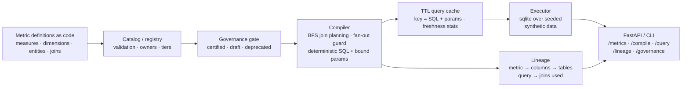

# Semantic Layer Metrics Platform

**Define each metric once, as code — and let every consumer get the same number: a governed catalog of measures, dimensions, entities and joins → a deterministic SQL compiler with join fan-out guards → execution, TTL caching, and metric-to-source lineage.**

`topic: data-engineering` · Python 3.11+ · stdlib-only core · FastAPI service surface

All data is **synthetic** (invented customers, products and orders from
a seeded generator) and all code is original — a clean-room build with
a generic retail-style domain, suitable for studying the architecture
without any real-world system behind it.

---

## The enterprise problem

Every team computes "revenue" slightly differently. One dashboard sums
gross amounts, another nets out refunds, a third joins orders to
customers in a way that double-counts. The numbers disagree in the
executive review, and nobody can say which one is right — because the
definition lives in a dozen SQL strings instead of one place.

A semantic layer fixes that only if it is more than a view folder:

1. **Definitions must be checkable.** A metric should name an entity,
   a column and an aggregation — never a free-form SQL string — so it
   can be validated, compiled and traced.
2. **Trust must be explicit.** Certified, draft and deprecated metrics
   are different promises. Querying a deprecated metric should fail
   loudly and name its replacement, not silently return a stale number.
3. **Joins must be safe.** The classic semantic-layer bug is fan-out:
   join a fact to a one-to-many table and every SUM quietly inflates.
   The compiler has to see cardinality and refuse.
4. **Lineage must be real.** "Where does this number come from?" is
   answered from the compiled query itself — tables, columns, joins —
   not from a diagram someone drew last year.

This platform is those pieces as one small, runnable system.

## Architecture



Full detail, decisions and failure-mode analysis: **[docs/architecture.md](docs/architecture.md)**.

## What it demonstrates

| Capability | Where |
|---|---|
| Metrics defined once as typed code: measures, dimensions, entities, joins with cardinality | `models.py`, `definitions.py` |
| Catalog validation: every column, table, join key and derived-metric part checked at build time | `catalog.py` |
| Deterministic SQL compiler: BFS join planning, bound parameters only, whitelist identifiers | `compiler.py` |
| Join fan-out guards: one-to-many traversal refuses SUM/COUNT, allows COUNT_DISTINCT or explicit opt-in | `compiler.py` |
| Governance: owners, gold/silver/bronze tiers, certified vs draft vs deprecated, certification & deprecation rules, audit report | `governance.py` |
| Derived ratio metrics (`discount_rate = total_discount / total_revenue`) with `NULLIF` zero-division guard | `compiler.py`, `definitions.py` |
| TTL result cache keyed on compiled SQL + params, with hit / miss / stale-miss accounting and LRU-style eviction | `cache.py` |
| Lineage from metric → measure column → source table, query lineage, and downstream (dependent) metrics | `lineage.py` |
| Deterministic synthetic sales/customer dataset in sqlite (stdlib) — fully offline, reproducible numbers | `executor.py` |
| FastAPI surface + CLI: metrics, compile, query, lineage, governance, cache stats | `service.py`, `cli.py` |

## Quick start

```bash
pip install -r requirements.txt
pip install -e .

# Run the test suite
PYTHONPATH=src python -m pytest -q

# End-to-end offline demo: compile revenue by region, run it, serve the
# repeat from cache, and show the draft / deprecated / fan-out gates
python examples/run_demo.py
# equivalently: semantic-layer demo
```

Sample compiled SQL (from the demo query — revenue by region, completed orders):

```sql
SELECT t_customer.region AS customer_region,
       SUM(t_order.amount) AS total_revenue,
       COUNT(t_order.order_id) AS order_count,
       COUNT(DISTINCT t_order.customer_id) AS unique_customers
FROM orders AS t_order
LEFT JOIN customers AS t_customer
  ON t_order.customer_id = t_customer.customer_id
WHERE t_order.status = ?
GROUP BY t_customer.region
ORDER BY total_revenue DESC
```

Run the service:

```bash
pip install -e ".[api]"
semantic-layer serve --port 8000
curl localhost:8000/metrics
curl localhost:8000/metrics/total_revenue
curl -X POST localhost:8000/query -H 'content-type: application/json' \
  -d '{"metrics": ["total_revenue"], "dimensions": ["customer_region"]}'
curl localhost:8000/lineage/discount_rate
curl localhost:8000/governance
```

Or with Docker: `docker build -t semantic-layer-metrics-platform . && docker run -p 8000:8000 semantic-layer-metrics-platform`

## Design decisions & trade-offs

* **No raw SQL in definitions, ever.** A metric is an entity, a column
  and an aggregation. That constraint is what buys validation, safe
  compilation (identifiers only from the catalog whitelist, values
  always bound parameters), and lineage. *Trade-off:* exotic measures
  need a new aggregation kind in the compiler rather than a quick
  string edit — which is the point.
* **Fan-out is refused, not repaired.** Traversing a one-to-many join
  inflates non-distinct measures; the compiler raises and names the
  join instead of silently deduplicating. Distinct-count metrics are
  recognised as fan-out-safe, and an explicit `allow_fanout` opt-in
  exists for callers who truly mean it.
* **Governance is a gate, not documentation.** Draft and deprecated
  metrics fail at compile time without explicit opt-in, and the
  deprecated error names the replacement. Certification has rules
  (owner, description, gold/silver tier) enforced by the same code
  that audits the catalog.
* **Deterministic SQL is a feature.** BFS join planning with sorted
  neighbours and request-ordered selects means the same request
  produces byte-identical SQL — golden tests are possible, and the
  result cache can key on SQL + parameters, the query's true identity.
* **Lineage is derived, not maintained.** Metric and query lineage are
  computed from the catalog and the compiled query, so they cannot
  drift from what actually runs.

## Repository layout

```
src/semantic_layer/
  models.py       Typed definitions: tables, entities, dimensions, joins, metrics, queries
  catalog.py      SemanticCatalog: registry + build-time validation of the whole model
  registry.py     MetricRegistry: the published, query-focused facade over the catalog
  definitions.py  Default semantic model over the synthetic sales dataset
  compiler.py     QueryRequest -> deterministic SQL: join planning, fan-out guard, params
  executor.py     Seeded synthetic dataset in sqlite + cached execution
  governance.py   Owners/tiers/status rules, certification, deprecation, audit report
  cache.py        TTL result cache keyed on SQL+params, freshness + eviction stats
  lineage.py      Metric lineage, query lineage, downstream dependents
  service.py      Framework-free service + FastAPI app factory (guarded import)
  cli.py          semantic-layer CLI (demo / metrics / compile / query / lineage / serve)
  demo.py         End-to-end demo: compile -> run -> cache -> lineage -> gates
tests/            pytest across compiler, governance, cache, lineage, errors, executor, service
docs/             Architecture deep-dive + CI template
examples/         run_demo.py
```

## Roadmap

- [ ] Time-dimension grains (day/week/month) and cumulative window metrics
- [ ] Warehouse executors (DuckDB/BigQuery/Snowflake) behind the executor seam
- [ ] Metric-level access control enforced at the governance gate
- [ ] Shared cache with invalidation on source-table refresh events
- [ ] Expression metrics beyond ratios, behind the same validation

## License

MIT — see [LICENSE](LICENSE).
